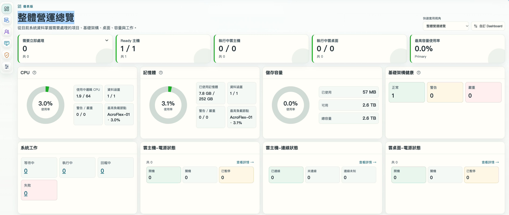
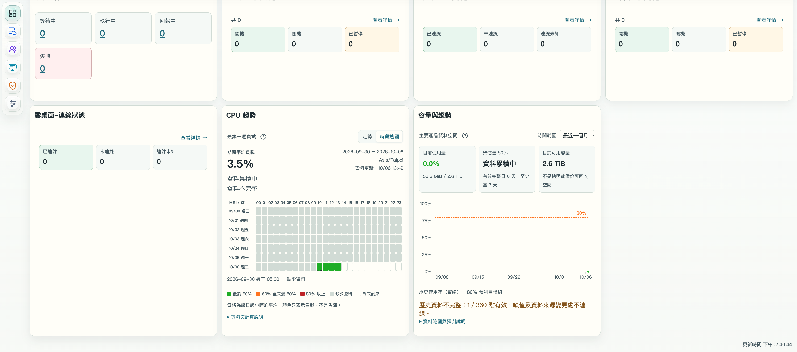
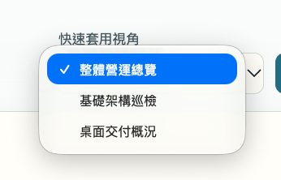
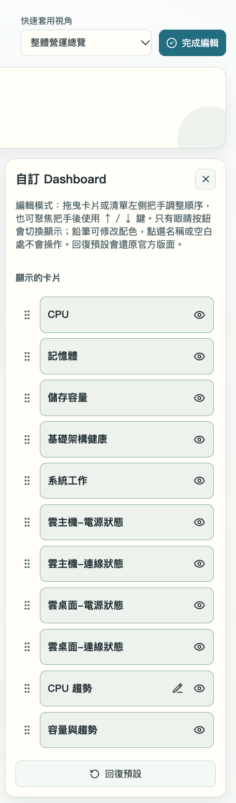
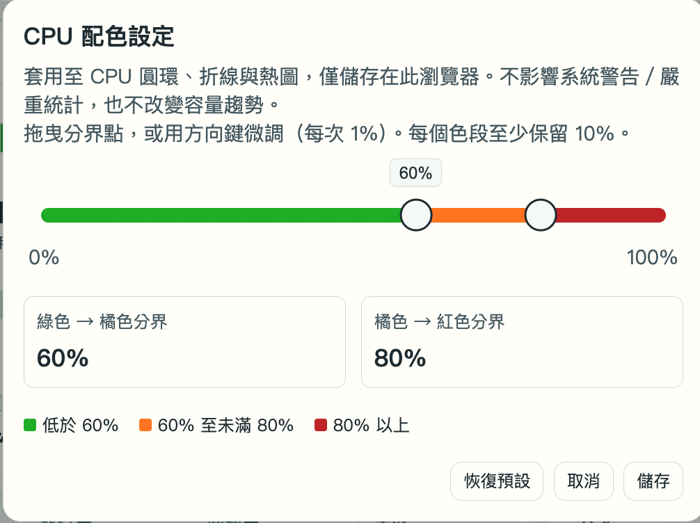

---

number: "3.3"
title: "整體營運總覽"
status: draft
source: index.md
---

# 3.3. 整體營運總覽

「整體營運總覽」是 AcroFlex Client 的營運資訊入口，以摘要指標、資源卡片及歷史圖表，協助管理人員掌握需要處理的項目、基礎架構、雲主機、雲桌面、容量與系統工作。

本節依五張操作截圖說明資訊判讀、視角切換、自訂卡片及 CPU 配色。與第 3.2 節的介面導覽不同，本節聚焦總覽內容；第 3.5 節「超融合主機雲狀態總覽」則是另一個管理頁面，不應混用兩者的欄位。

## 前置條件與適用範圍

- 已登入 AcroFlex Client，且帳號可存取整體營運總覽。
- 確認正在查看預期的 AcroFlex 環境；實際可見資料依版本、權限及部署組態而異。
- 本節數值、主機名稱、日期、配色分界與視角均取自截圖，是示例，不代表產品預設值。
- 歷史圖表須有足夠資料才可判讀趨勢；「資料累積中」「資料不完整」不能直接解讀為資源異常或資料遺失。

## 進入整體營運總覽

1. 在 AcroFlex Client 左側主功能列選取最上方的四格圖示。截圖中的功能位置標示為「儀表版」，頁面主標題為「整體營運總覽」。本手冊以「整體營運總覽」稱呼這個功能。
2. 確認頁面主標題及右上方的「快速套用視角」。
3. 選擇「整體營運總覽」，查看所有卡片；如卡片已自訂為隱藏，須另確認自訂設定。
4. 由上方摘要開始，再查看資源、健康、工作與歷史圖表。向下捲動以檢視後續卡片。

預期結果是進入圖 3.3-1 與圖 3.3-2 所示的資訊頁面。僅開啟總覽不代表已完成健康檢查；仍須核對資料涵蓋範圍、狀態與更新時間。

## 畫面總覽與摘要指標

圖 3.3-1　整體營運總覽上半部：摘要指標、資源、基礎架構健康、系統工作與虛擬資源狀態。

圖 3.3-2　整體營運總覽下半部：雲桌面連線狀態、CPU 趨勢及容量與趨勢。此圖上緣與圖 3.3-1 有重疊，並非另一組重複卡片。

### 上方摘要指標

| 指標       | 截圖示例          | 用途與判讀限制                                                            |
| -------- | ------------- | ------------------------------------------------------------------ |
| 需要立即處理   | 0，下方「共 0」     | 用於優先注意待處理項目。卡片旁有下拉箭頭，但截圖未展開；項目來源、分類及兩個數字的精確關係待確認。不能僅憑 0 就判定所有服務正常。 |
| Ready 主機 | 1 / 1，下方「共 1」 | 呈現 Ready 主機摘要。應與基礎架構健康及主機詳細狀態核對；分子、分母的主機角色涵蓋範圍待確認。                 |
| 執行中雲主機   | 0 / 0，下方「共 0」 | 呈現雲主機執行摘要。不要將比例的分母自行解讀為授權上限；精確統計口徑待確認。                             |
| 執行中雲桌面   | 0 / 0，下方「共 0」 | 呈現雲桌面執行摘要；不等同已連線使用者數。精確統計口徑待確認。                                    |
| 最高容量使用率  | 0.0%，Primary  | 指出目前摘要中的最高容量使用率及對應名稱。Primary 是截圖的顯示標籤，不代表所有環境的儲存名稱都相同。             |

### CPU

| 欄位        | 截圖示例               | 說明                                                           |
| --------- | ------------------ | ------------------------------------------------------------ |
| 使用率       | 3.0%               | 以圓環與百分比呈現 CPU 使用情況。不是單一虛擬機器的 CPU 使用率。聚合方式與取樣週期待確認。           |
| 使用中邏輯 CPU | 1.9 / 64           | 呈現使用量及邏輯 CPU 資源摘要。1.9 是畫面中的使用量指標，不是 1.9 顆實體處理器，表示使用率約1.9個核心。 |
| 資料涵蓋      | 1 / 1              | 協助檢查統計資料涵蓋程度。應配合主機清單確認涵蓋對象，不能單看使用率。                          |
| 警告 / 嚴重   | 0 / 0              | 呈現對應層級的統計。這些數字不會因修改 CPU 配色分界而改變。                             |
| 最高負載節點    | AcroFlex-01 · 3.0% | 協助定位需要進一步查看 CPU 負載的節點；名稱與百分比都是示例。                            |

CPU 標題旁有說明圖示；截圖未開啟說明內容，本節不自行補出平均方式、警告門檻或取樣間隔。

### 記憶體

| 欄位      | 截圖示例               | 說明                                            |
| ------- | ------------------ | --------------------------------------------- |
| 使用率     | 3.1%               | 呈現記憶體使用比例。                                    |
| 已使用記憶體  | 7.8 GB / 252 GB    | 呈現已使用量與資源總量；總量為畫面統計值，不能直接當成某台 AcroCube 的安裝規格。 |
| 資料涵蓋    | 1 / 1              | 用於核對記憶體資料涵蓋程度；精確對象範圍待確認。                      |
| 警告 / 嚴重 | 0 / 0              | 呈現記憶體相關的層級統計；判斷門檻須依產品對應說明確認。                  |
| 最高負載節點  | AcroFlex-01 · 3.1% | 用於定位記憶體負載最高的節點，再到主機詳細頁面檢查。                    |

### 儲存容量

| 欄位  | 截圖示例   | 說明                                  |
| --- | ------ | ----------------------------------- |
| 使用率 | 0.0%   | 顯示使用比例，可能因顯示精度而四捨五入；0.0% 不等於完全沒有資料。 |
| 已使用 | 57 MB  | 當前統計的使用容量。                          |
| 可用  | 2.6 TB | 當前可用容量，不應視為仍可完整分配給新工作負載的保證。         |
| 總容量 | 2.6 TB | 目前統計的容量總量。是否扣除保留空間及其他計算規則待確認。       |

容量卡片與歷史卡片顯示的單位不同：圖 3.3-1 使用 MB／TB，圖 3.3-2 使用 MiB／TiB。比較時應先確認單位及資料更新時間，不直接以顯示數字判定兩者矛盾。

### 基礎架構健康

卡片將健康資訊分為「正常」「警告」「嚴重」，截圖分別顯示 1、0、0。先查看警告與嚴重項目，再到基礎架構管理確認對象、目前狀態及相關事件。精確涵蓋的資源類型與健康分級規則尚待確認，不將數字直接視為某一種主機的確定數量。

### 系統工作

「系統工作」按「等待中」「執行中」「回報中」「失敗」分類，截圖各值均為 0，數字呈連結樣式。

- 等待中：注意尚在等候處理的工作。
- 執行中：注意目前正在處理的工作。
- 回報中：表示工作處於介面所稱的回報狀態；具體流程及完成條件待確認，不將其當成成功。
- 失敗：優先檢查相應工作及錯誤訊息，保留時間與工作識別資訊。

所有數字為 0 不代表歷史作業全部成功。截圖未顯示各連結的目的頁與查詢時間範圍，須在實際操作時核對。

### 雲主機與雲桌面的電源、連線狀態

| 卡片       | 分類           | 判讀方式                                     |
| -------- | ------------ | ---------------------------------------- |
| 雲主機–電源狀態 | 開機、關機、已暫停    | 用於辨識雲主機的電源狀態分布；圖中「共 0」，各項為 0。            |
| 雲主機–連線狀態 | 已連線、未連線、連線未知 | 用於查看連線狀態分布；圖中各項為 0。連線對象與判定機制待確認。         |
| 雲桌面–電源狀態 | 開機、關機、已暫停    | 用於辨識雲桌面的電源狀態分布；圖中「共 0」，各項為 0。            |
| 雲桌面–連線狀態 | 已連線、未連線、連線未知 | 用於查看雲桌面連線狀態分布；圖中各項為 0。連線未知不應直接解讀為未連線或故障。 |

這四張卡片均有「查看詳情 →」入口。需要定位個別資源時，可由入口開啟詳情，再核對頁面標題、資源名稱與狀態。截圖未顯示跳轉目的頁，本節不指定未確認的頁籤名稱。

電源與連線是不同指標：開機不代表已連線，未連線也不能單獨證明已關機。判斷交付問題時，須同時查看兩者與相關事件。

## CPU 趨勢

圖 3.3-2 的「CPU 趨勢」卡片提供「走勢」與「時段熱圖」切換，截圖選取「時段熱圖」。卡片標示「叢集一週負載」，呈現期間平均負載、日期範圍、時區、資料更新時間及資料完整性提示。

| 項目     | 截圖示例／說明                                          |
| ------ | ------------------------------------------------ |
| 期間平均負載 | 3.5%；用於查看所示期間的平均負載，不等同上方 CPU 卡片的當前使用率。平均計算細節待確認。 |
| 日期範圍   | 2026-09-30 至 2026-10-06。                         |
| 時區     | Asia/Taipei；比對事件及其他圖表時應確認時間基準。                   |
| 資料更新   | 10/06 13:49；是本卡片顯示的資料更新時間，不應視為所有卡片都使用同一時間。       |
| 完整性提示  | 「資料累積中」「資料不完整」；表示尚不足以做完整期間的負載判斷。                 |

時段熱圖的列代表日期、欄代表 00 至 23 時；每格為該日該小時的平均。圖例中的配色分段為：低於 60%、60% 至未滿 80%、80% 以上、缺少資料、尚未到來。灰色的「缺少資料」不是 0% 負載，未來時段也不是監控故障。

卡片明確說明「顏色只表示負載，不是告警」。因此不能用熱圖的紅色直接判定系統已產生嚴重事件，也不能用綠色單獨證明整個系統健康。下方「資料與計算說明」可用於進一步核對定義；截圖未展開其內容。

可切換「走勢」查看另一種呈現方式，但目前素材沒有提供該畫面，不預先描述其曲線、取樣點或互動方式。

## 容量與趨勢

「容量與趨勢」卡片以「主要產品資料空間」為統計標題，提供「時間範圍」選擇；截圖選取「最近一個月」。

| 項目      | 截圖示例                    | 判讀方式                                                    |
| ------- | ----------------------- | ------------------------------------------------------- |
| 目前使用量   | 0.0%；56.5 MiB / 2.6 TiB | 呈現當前容量使用情況；百分比有顯示精度限制。                                  |
| 預估達 80% | 資料累積中；有效完整日 0 天，至少需 7 天 | 此時沒有可採用的預估日期。「至少需 7 天」是截圖明示的資料條件，不是收集滿 7 天就一定產生有效預測的保證。 |
| 目前可用容量  | 2.6 TiB                 | 畫面註明「不是快照或備份可回收空間」，不能當成刪除快照或備份後可增加的容量。                  |
| 圖表      | 歷史使用率（實線）、80% 預測目標線     | 用於比較歷史使用情況與預測目標。80% 目標線不是本節 CPU 配色設定的橘色／紅色分界。           |
| 歷史資料完整性 | 1 / 360 點有效             | 圖中說明缺值及資料來源變更處不連線；曲線中斷不應立即解讀為容量下降。                      |

資料不足時，先確認目前使用量與可用容量，再核對完整性提示，不據此承諾多久後會用滿。需規劃容量時，應搭配實際工作負載、成長情況及完整歷史資料。卡片下方另有「資料範圍與預測說明」入口，詳細預測演算法待其內容確認。

## 切換快速套用視角

圖 3.3-3　快速套用視角選單。勾選符號標示目前選取「整體營運總覽」。

依本節綱要，視角分為三類：

| 視角     | 用途                         |
| ------ | -------------------------- |
| 整體營運總覽 | 顯示所有卡片，適合完整巡查。             |
| 基礎架構巡檢 | 顯示基礎架構相關卡片，適合檢查主機、資源與健康資訊。 |
| 桌面交付概況 | 顯示虛擬機器與雲桌面交付相關卡片，適合查看交付狀態。 |

操作方式：

1. 在頁面右上方開啟「快速套用視角」下拉選單。
2. 選取符合目前檢查目的的視角。
3. 確認選單顯示所選名稱，並檢查實際顯示的卡片。
4. 若資訊不足，切回「整體營運總覽」，或檢查自訂卡片設定。

視角用於調整檢視內容，不代表已執行修復或完成巡檢。素材僅顯示視角選項，未提供後兩類的完整畫面；各類確切卡片清單，以及切換視角是否覆寫自訂配置，列為待確認事項。

## 自訂卡片的顯示與排列

圖 3.3-4　自訂 Dashboard 編輯面板。頁面上方顯示「完成編輯」，面板內列出 11 張可設定卡片。

### 控制項與卡片清單

| 控制項          | 用途                                      |
| ------------ | --------------------------------------- |
| 自訂 Dashboard | 圖 3.3-1 右上方的編輯入口。                       |
| 左側把手         | 拖曳卡片或清單左側把手調整順序；把手取得焦點後也可使用 ↑／↓ 鍵。      |
| 眼睛按鈕         | 切換卡片顯示或隱藏。面板明示只有眼睛按鈕會切換顯示，點選名稱或空白處不會操作。 |
| CPU 趨勢旁的鉛筆按鈕 | 開啟 CPU 配色設定，不是調整系統告警門檻。                 |
| 完成編輯         | 編輯模式上方的完成入口；完成後應確認卡片顯示及順序。              |
| 回復預設         | 還原官方版面，可能取代目前的顯示與排列偏好；操作前先記錄現有配置。       |
| 面板右上方 ×      | 面板關閉入口，與「完成編輯」的保存行為相同。                  |

可設定卡片為 CPU、記憶體、儲存容量、基礎架構健康、系統工作、雲主機–電源狀態、雲主機–連線狀態、雲桌面–電源狀態、雲桌面–連線狀態、CPU 趨勢、容量與趨勢。上方五個摘要指標沒有列在這張清單中，不假設也能用相同方式隱藏。

### 操作步驟與確認

1. 在總覽右上方點選「自訂 Dashboard」，確認出現編輯面板與「完成編輯」。
2. 找到要調整的卡片名稱，點選其右側眼睛按鈕。
3. 檢查該卡片在頁面中是否依預期顯示或隱藏；不要把隱藏當成停止監控或解決異常。
4. 若要調整順序，拖曳把手；或將焦點移至把手後按 ↑／↓ 鍵。
5. 點選「完成編輯」，確認主要資訊仍可見，且排列符合巡檢需求。
6. 需要還原官方版面時，先確認可捨棄目前偏好，再使用「回復預設」，並核對還原結果。

卡片版面設定的儲存位置、跨瀏覽器／帳號共用範圍，以及重載後保存方式未由素材說明，尚待確認；不要套用 CPU 配色的瀏覽器儲存規則來推定整個 Dashboard。

## CPU 圖表配色分界設定

> 重要：綱要將本項稱為「CPU 歷史資料的閾值」，調整閾值後，CPU便會在閾值區域顯示綠色、橘色或紅色。此設定套用至 CPU 圓環、折線與熱圖，僅儲存在目前瀏覽器，不影響系統警告／嚴重統計，也不改變容量趨勢。

圖 3.3-5　CPU 配色設定。截圖的綠色／橘色分界為 60%，橘色／紅色分界為 80%。

### 分界與限制

| 項目        | 說明                                                      |
| --------- | ------------------------------------------------------- |
| 綠色 → 橘色分界 | 圖中為 60%；低於此值顯示綠色，達到此值後進入橘色區段。                           |
| 橘色 → 紅色分界 | 圖中為 80%；60% 至未滿 80% 顯示橘色，80% 以上顯示紅色。                    |
| 調整方式      | 拖曳滑桿上的分界點，或使用方向鍵微調，每次 1%。                               |
| 色段限制      | 每個色段至少保留 10%；兩個分界值必須維持合理間隔，不可任意重疊。                      |
| 保存範圍      | 僅儲存在此瀏覽器，不是全系統或跨瀏覽器設定。                                  |
| 恢復預設      | 配色設定內的預設還原入口，與 Dashboard 的「回復預設」版面按鈕不同。截圖值不自動視為已確認的預設值。 |
| 取消、儲存     | 分別用於取消本次調整或保存配色設定。                                      |

### 操作步驟與結果驗證

1. 在「自訂 Dashboard」面板中，找到「CPU 趨勢」，點選鉛筆按鈕。
2. 確認開啟的視窗標題為「CPU 配色設定」，先閱讀其適用範圍與限制。
3. 拖曳綠色／橘色分界點，確認顯示的百分比。
4. 調整橘色／紅色分界點，確認每個色段至少保留 10%；需要細調時使用方向鍵。
5. 核對下方色彩圖例與兩個分界值，再點選「儲存」。不採用本次變更時選擇「取消」。
6. 返回總覽，檢查 CPU 圓環及可用的歷史圖表是否依新分界呈現。
7. 如需還原配色，開啟同一視窗使用「恢復預設」，檢查顯示值後再儲存。

修改配色不會改變 CPU 使用率本身，也不是變更系統告警條件。驗證重點是色彩分段是否符合設定，而不是要求「警告／嚴重」統計改變。清除瀏覽器資料後是否保留設定、同瀏覽器不同登入帳號是否共用設定，仍需確認。

## 由總覽定位需要處理的對象

建議按照下列順序進行例行檢查：

1. **核對環境與資料時間：** 確認目前系統、視角及卡片更新時間。圖 3.3-2 右下方有頁面更新時間，但不能據此假設每張歷史卡片已收集同樣完整的資料。
2. **查看待處理與健康資訊：** 優先注意「需要立即處理」及「警告」「嚴重」項目；進入基礎架構管理核對實際對象與事件。
3. **核對資源與涵蓋程度：** 查看 CPU、記憶體、儲存使用情況，以及最高負載節點。涵蓋不足時，不以低負載推定所有節點都正常。
4. **核對工作狀態：** 查看等待、執行、回報及失敗工作，再於任務／記錄區確認細節。不要因顏色或數字為 0 就省略結果驗證。
5. **核對交付狀態：** 比較雲主機／雲桌面的電源與連線分類，使用「查看詳情」定位資源，確認狀態未知或未連線的原因。
6. **判讀歷史趨勢：** 先看日期、時區、缺值與完整性提示，再分析 CPU 時段負載及容量變化；資料累積中時不給出確定預測。
7. **保留排查資訊：** 記錄異常對象、時間、畫面訊息與相關工作識別資訊。後續涉及主機、虛擬資源或儲存變更時，依對應操作章節執行，不在總覽直接推定修復方式。

## 注意事項與待確認事項

- 配色、卡片隱藏與視角是呈現設定，不是服務修復、停用監控或變更資源配置。
- 截圖沒有顯示產品版本及精確權限矩陣，正式發佈前需確認適用版本與可存取角色。
- 待確認摘要比例、Ready 主機與資料涵蓋的精確統計口徑，CPU／記憶體平均方法，以及基礎架構健康分級規則。
- 待確認「需要立即處理」展開內容、系統工作各狀態的完整定義，以及各「查看詳情」入口的目的頁。
- 待確認「基礎架構巡檢」「桌面交付概況」的確切卡片清單、視角與自訂配置的交互關係，以及卡片版面的保存範圍。
- 待確認 CPU「走勢」、說明圖示與可展開說明內容，以及容量統計範圍與預測計算方式。
- 資料不完整時保留限制說明，不將缺值視為零值，不將預測目標線當成系統告警條件。
