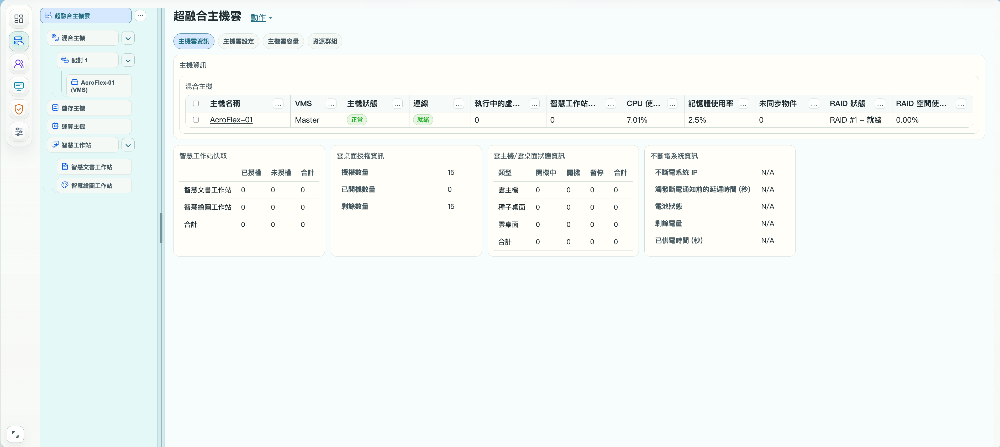

# 3.4. 超融合基礎架構管理頁面說明

超融合基礎架構管理頁面用於查看及管理構成 AcroFlex 系統的硬體裝置。管理範圍包含混合主機、運算主機、儲存主機、智慧文書工作站及智慧繪圖工作站，並延伸至相關網路設定、電源狀態、不斷電系統（UPS）、硬體效能設定、磁碟陣列狀態及韌體管理。

AcroCube 指實體超融合主機硬體；AcroFlex 指由一台或多台 AcroCube 建立的超融合系統。本節以 AcroFlex Client 的基礎架構頁面說明「選擇裝置 → 查看狀態 → 核對操作範圍」的基本流程，個別設定與具風險的變更仍依對應章節執行。

與第 3.3 節「整體營運總覽」不同，本頁以主機雲及硬體裝置為管理對象，可由裝置分類、主機配對與個別主機逐層定位資訊。

## 前置條件

- 已成功登入 AcroFlex Client，且具有基礎架構管理權限。
- 確認目前連線的 AcroFlex 系統是預期環境。
- 查看資訊前，先辨識目標裝置的名稱、類型及所屬配對。
- 執行設定或變更前，確認相關工作負載、主機連線與儲存狀態，並檢查是否有尚未完成或可能衝突的任務。
- 影響網路、電源、主機角色、磁碟陣列或韌體的操作，須先依對應章節確認影響範圍與必要維護安排。

## 開啟基礎架構管理頁面

1. 在 AcroFlex Client 左側主功能列選取主機雲基礎架構管理圖示。圖 3.4-1 中為由上往下第二個、呈選取狀態的圖示。
2. 在其右側的裝置樹狀目錄選取「超融合主機雲」。
3. 確認右側工作區標題同樣為「超融合主機雲」。
4. 選取「主機雲資訊」，查看主機資訊及下方統計卡片。
5. 若要查看個別裝置，展開對應分類與配對，再選取目標裝置；切換後先核對工作區標題與管理對象。

預期結果是顯示圖 3.4-1 的主機雲管理畫面。進入頁面只代表可檢視資訊，不代表所有裝置均正常，也不代表已取得所有變更操作的權限。

## 畫面分區與裝置導覽

圖 3.4-1　超融合基礎架構管理頁面。圖中選取「超融合主機雲」及「主機雲資訊」；主機名稱、資源數值與狀態均為截圖示例。

| 區域 | 畫面內容 | 使用方式 |
| --- | --- | --- |
| 主功能列 | 最左側的功能圖示 | 選擇主機雲基礎架構管理。 |
| 裝置樹狀目錄 | 超融合主機雲、主機類別、配對及智慧工作站分類 | 選擇要查看的管理範圍；展開分類不等於已選取個別主機。 |
| 右側資訊與操作區 | 標題、動作入口、頁籤、主機列表及資訊卡片 | 查看目前對象的詳細狀況，核對可操作項目與影響範圍。 |

依綱要，選取「超融合主機雲」可進入整體硬體管理範圍；裝置分別由類別與頁籤呈現，不應將圖中目前只有一列的混合主機列表，視為所有環境的全部裝置清單。

### 裝置類型及階層關係

| 類型或項目 | 用途與辨識方式 |
| --- | --- |
| 超融合主機雲 | 主機雲層級的管理入口，適合先掌握整體裝置與統計資訊。 |
| 混合主機 | 同時提供運算與儲存功能的超融合主機。圖中依「混合主機 → 配對 1 → AcroFlex-01 (VMS)」排列。 |
| 儲存主機 | 以儲存功能為主要角色的超融合主機分類；角色轉換及限制應依對應章節確認。 |
| 運算主機 | 提供運算功能的超融合主機分類。綱要中的「計算超融合主機」，本節統一依介面稱為「運算主機」。 |
| 智慧工作站 | 下分「智慧文書工作站」與「智慧繪圖工作站」，用於選擇相應工作站管理類別。 |

「配對 1」與「AcroFlex-01」是示例，不是固定名稱。「(VMS)」是主機的標示，應配合右側 VMS 角色資訊判讀，不將名稱標示直接視為角色切換完成的證據。

分類旁的箭頭可用於展開或收折下層項目；「超融合主機雲」旁的「…」是下拉選單，點選後可展開選項。後續章節將說明並使用此選單，本節先介紹其位置與用途。

### 右側頁籤與動作入口

圖中標題旁有「動作」下拉入口，下方頁籤依序為「主機雲資訊」「主機雲設定」「主機雲容量」「資源群組」，目前選取「主機雲資訊」。

- 主機雲資訊：圖中顯示主機資訊、混合主機列表及四張統計卡片。
- 主機雲設定、主機雲容量、資源群組：提供相應主題的入口，但本圖未呈現其內容；具體設定欄位與操作流程須由後續素材確認。
- 動作：目前對象的操作入口。使用前先核對是主機雲、配對、單一主機還是工作站，不假設同名入口在不同對象上提供相同功能。

## 混合主機列表的欄位判讀

圖 3.4-1 的「主機資訊」中列出一台混合主機。部分表頭因欄寬省略，以下保留可辨識文字；完整名稱及統計定義待實際介面確認。

| 欄位 | 截圖示例 | 說明與限制 |
| --- | --- | --- |
| 核取方塊 | 未勾選 | 選取列表中的項目。操作前須核對選取對象，不能只看所在頁面標題。 |
| 主機名稱 | AcroFlex-01 | 識別主機，文字呈連結樣式；可由此辨識欲查看的裝置。 |
| VMS | Master | 顯示主機的 VMS 角色；Master 是此圖的值，不代表所有主機皆使用相同角色。 |
| 主機狀態 | 正常 | 主機狀態摘要。仍須配合連線、儲存、網路與事件資訊判讀。 |
| 連線 | 就緒 | 顯示連線狀態，不應直接解讀為所有實體網路介面與所有服務均正常。 |
| 執行中的虛… | 0 | 與執行中的虛擬資源相關之數量欄；完整名稱與涵蓋範圍待確認。 |
| 智慧工作站… | 0 | 與智慧工作站相關之統計欄；完整名稱及對象範圍待確認。 |
| CPU 使… | 7.01% | CPU 使用相關百分比；統計方式與取樣時間待確認，不套用其他截圖的數值。 |
| 記憶體使用率 | 2.5% | 顯示主機記憶體使用百分比。 |
| 未同步物件 | 0 | 尚未同步的物件數；數值為 0 不等同已完成備份或已通過所有資料保護檢查。 |
| RAID 狀態 | RAID #1 – 就緒 | 顯示磁碟陣列及狀態；仍須到相關詳細頁面確認磁碟與陣列資訊。 |
| RAID 空間使… | 0.00% | RAID 空間使用相關百分比；完整名稱與容量計算方式待確認。 |

表頭旁的「…」按鈕也是下拉選單入口。後續章節將說明並使用相關選項；本節不預先列出截圖未顯示的選單內容。

## 下方資訊卡片

### 智慧工作站快取

此卡片按「智慧文書工作站」「智慧繪圖工作站」及「合計」列出資料，欄位為「已授權」「未授權」「合計」，截圖中各值均為 0。

此資訊與工作站快取主題相關，不能將其數值直接當成雲桌面授權數、快取容量或命中率。精確統計單位與範圍尚待確認。

### 雲桌面授權資訊

| 欄位 | 截圖示例 | 判讀方式 |
| --- | --- | --- |
| 授權數量 | 15 | 此環境顯示的授權數量，不是產品預設授權。 |
| 已開機數量 | 0 | 目前顯示的已開機數量，應與雲桌面實際狀態核對。 |
| 剩餘數量 | 15 | 此時的剩餘數量，不是任何組態下都可再建立或啟動 15 台的保證；仍須確認資源與適用授權條件。 |

### 雲主機／雲桌面狀態資訊

畫面卡片名稱為「雲主機/雲桌面狀態資訊」，按「雲主機」「種子桌面」「雲桌面」及「合計」分類，顯示「開機中」「關機」「暫停」「合計」四種統計欄，截圖數值均為 0。

應以介面原文字樣判讀「開機中」，不自行認定為某一啟動階段；數值為 0 亦不能用來證明所有歷史工作已成功。需要確認個別工作負載時，進入雲主機／雲桌面管理核對目標資源。

### 不斷電系統資訊

| 欄位 | 說明 |
| --- | --- |
| 不斷電系統 IP | UPS 的連線位址資訊。截圖為 N/A，未提供可套用的位址。 |
| 觸發斷電通知前的延遲時間 (秒) | 顯示斷電通知前的延遲設定，單位為秒；不是保證可維持供電的時間。 |
| 電池狀態 | 顯示 UPS 電池相關狀態。 |
| 剩餘電量 | 顯示剩餘電量資訊；圖中沒有有效值，不能據此計算續航時間。 |
| 已供電時間 (秒) | 顯示供電時間資訊，單位為秒；計時起點及重置條件待確認。 |

圖中五項均為 N/A，表示此畫面未提供可判讀值。不能直接認定 UPS 已故障、未安裝或已正確設定；應到停電防護相關設定及實際 UPS 狀態核對。

## 硬體管理範圍與操作前檢查

以下範圍依本節綱要與父章規劃整理；圖 3.4-1 未展示所有詳細設定及操作選單，不將這些項目寫成已確認的按鈕流程。

| 管理範圍 | 操作前應核對的內容 | 後續閱讀 |
| --- | --- | --- |
| 主機角色與配對 | 主機名稱、角色、配對關係、同步狀態、工作負載及未完成任務。 | 第 3.7 節增加容錯主機、第 3.9 節新增主機配對、第 3.10／3.11 節角色轉換。 |
| 運算主機與工作站 | 欲增加或移除的對象，以及其上的執行中工作負載。 | 第 3.12–3.17 節。 |
| 網路與管理連線 | 變更對象、目前位址及連線狀態；評估是否會中斷管理連線或工作負載通訊。 | 第 3.26 節虛擬交換器說明及相關網路設定章節。 |
| 主機電源與執行模式 | 主機角色、VMS 所在位置、工作負載、維護安排與任務狀態。 | 第 3.18 節切換 VMS、第 3.19／3.20 節維護與正常模式。 |
| UPS 與停電防護 | UPS 連線、電池狀態、通知設定與實際供電條件；不可用 N/A 當成正常值。 | 第 7 章停電防護系統。 |
| 硬體資源與效能設定 | CPU、記憶體與使用情況；先確認設定的作用範圍，不將數值摘要當成調校依據。 | 第 3.24／3.25 節主機資訊與資源說明。 |
| 磁碟陣列與同步 | RAID 狀態、磁碟狀況、未同步物件與相關記錄；變更前確認資料保護及影響。 | 第 2.4 節及主機儲存相關說明。 |
| 系統與工作站韌體 | 正確裝置、適用韌體、版本、工作負載、維護安排及更新任務。 | 第 3.21–3.23 節韌體上傳與更新。 |

## 基本檢查流程與結果驗證

1. **選擇管理範圍：** 先選「超融合主機雲」掌握資訊，再由裝置樹定位類別、配對與個別裝置。
2. **辨識目標：** 對照左側選取項目、右側標題及主機名稱，避免在主機雲層級誤以為只操作單一主機。
3. **檢視狀態：** 依序查看角色、主機狀態、連線、CPU、記憶體、同步與 RAID 資訊；需要時進入詳細頁面核對。
4. **確認條件：** 如準備進行變更，先查閱對應章節並核對權限、工作負載及維護條件，不直接由未確認的選單執行高風險操作。
5. **執行對應操作：** 依已確認的操作章節輸入設定及核對目標；本節不提供未由素材確認的輸入值或復原指令。
6. **追蹤任務：** 若操作產生背景任務，至任務與記錄區確認進度及結果。按下按鈕不等於完成；任務未結束前不要反覆提交相同作業。
7. **驗證結果：** 返回目標裝置頁面，核對設定與狀態，並確認預期服務可用。若資訊不一致，保留事件時間、對象及完整訊息，先確認原因再進行後續變更。

## 注意事項與待確認事項

- 本圖是主機雲資訊頁，未顯示個別裝置的全部設定。不可將未展開分類或空白處直接解讀為沒有該類資源。
- 不僅依「正常」「就緒」或單一百分比判定系統健康；應配合工作負載、儲存、網路與相關記錄。
- 不將截圖中的主機名稱、授權數量、使用率與 N/A 套用為其他環境的設定或預設值。
- 主機角色、配對、網路、電源、韌體及儲存變更可能影響服務與資料可用性，操作前須核對範圍及對應章節；本節不保證可在不中斷服務的條件下執行。
- 待確認截圖適用版本、權限矩陣、截斷表頭的完整名稱，以及各項統計定義。
- 「…」下拉選單的選項與操作將於後續章節說明；本節不重複展開其詳細流程。
- 待補充「動作」選單、主機雲設定／容量／資源群組與個別裝置詳細畫面，才能完成其具體欄位、操作與驗證說明。
- 章節名稱待統一：index.md 的主標題為「超融合基礎架構之硬體管理說明」，其 title 欄位及父章目錄仍為「超融合基礎架構管理頁面說明」。本草稿暫沿用既有章節識別，內容依更新後的硬體管理綱要撰寫。
